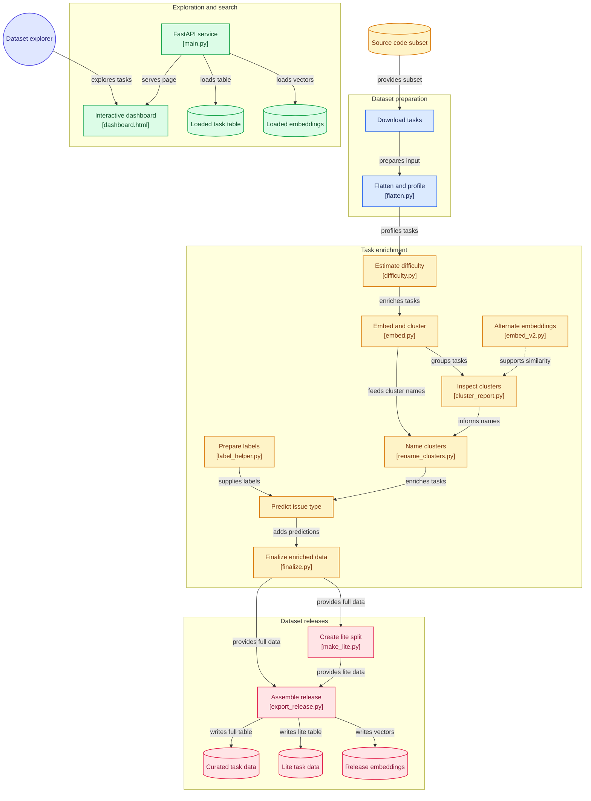
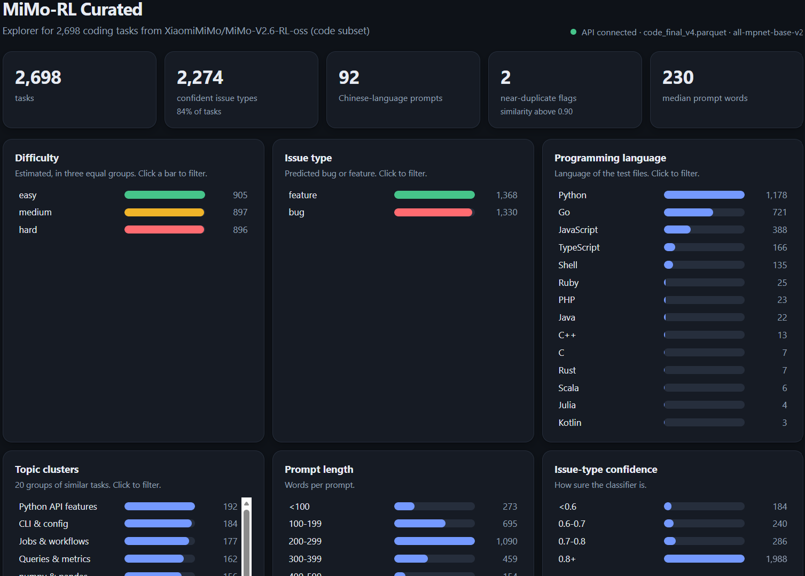
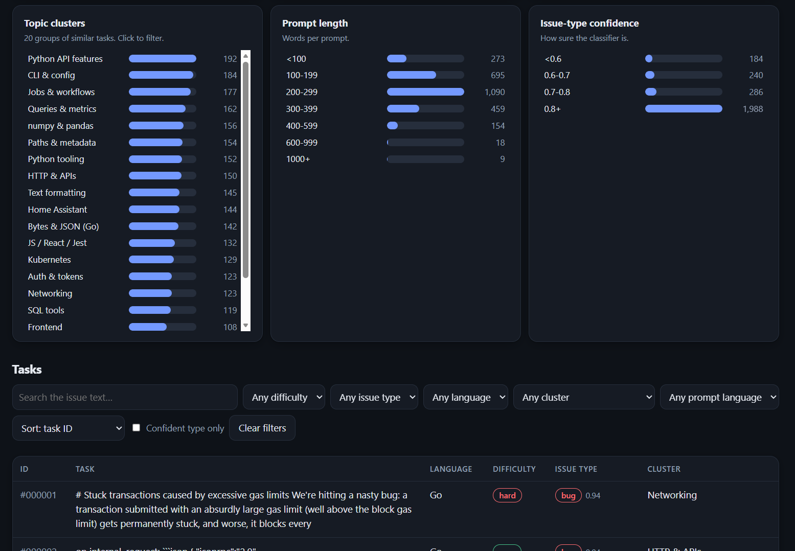
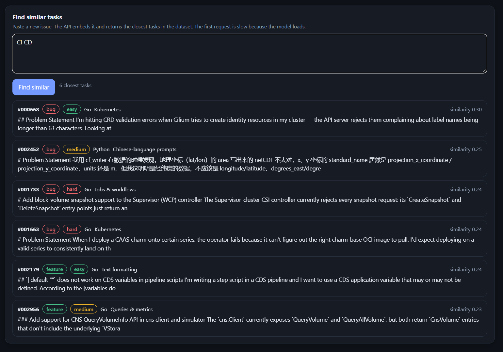

# MiMo-RL Curated

[](https://huggingface.co/datasets/Aswina1636/mimo-rl-curated-code)
[](https://github.com/ASWINa1636/MiMo-RL-Curated)
[](LICENSE)


**A data-cleaning, enrichment, exploration, and search pipeline for the
code subset of Xiaomi MiMo's reinforcement-learning environments
dataset.**

MiMo-RL Curated transforms the original, nested software-engineering
tasks into a more approachable dataset with profiling metadata,
estimated task complexity, semantic clusters, similarity signals, and
predicted issue types. It also provides a FastAPI backend and a
lightweight HTML/CSS/JavaScript dashboard for exploring the results.

> **Scope:** This release focuses on the **2,698-task `code` subset**.
> It does not claim to have processed all five subsets of the original
> MiMo-V2.6-RL-oss dataset.

## Links

-   **Original dataset:** [XiaomiMiMo/MiMo-V2.6-RL-oss](https://huggingface.co/datasets/XiaomiMiMo/MiMo-V2.6-RL-oss)
-   **Curated dataset:** [Aswina1636/mimo-rl-curated-code](https://huggingface.co/datasets/Aswina1636/mimo-rl-curated-code)
-   **Source code:** [ASWINa1636/MiMo-RL-Curated](https://github.com/ASWINa1636/MiMo-RL-Curated)

## Why this project exists

The original `code` subset contains GitHub issue-style software
engineering tasks. Its records include nested fields, and the raw data
does not directly provide all the practical filters and summaries that
people may want when exploring tasks.

MiMo-RL Curated makes those records easier to inspect and reuse by:

-   Flattening nested records into ordinary, readable columns.
-   Measuring prompt length and extracting metadata from test patches.
-   Estimating relative task complexity from measurable signals.
-   Embedding task text so semantically related tasks can be grouped and
    searched.
-   Grouping tasks into 20 semantic clusters and assigning readable
    topic names.
-   Flagging potential near-duplicates for review.
-   Predicting whether a task appears to describe a bug or a feature,
    with a confidence score.
-   Providing a 500-task lite split for quick experiments.
-   Exposing the data through an API and an interactive dashboard.

The project is intended to support dataset exploration, filtering,
data-quality investigation, and experimentation. It does **not** execute
the software-engineering tasks or prove that a task is easy for an AI
model.

## Dataset at a glance

| Item | Details |
|---|---|
| Source | XiaomiMiMo/MiMo-V2.6-RL-oss |
| Subset processed | `code` |
| Number of tasks | 2,698 |
| Curated full release | 2,698 rows |
| Lite release | 500 rows |
| Lite sampling | 25 tasks from each of 20 clusters |
| Semantic clusters | 20 |
| Embeddings | `all-mpnet-base-v2`, 768 dimensions per task in the release |
| Main formats | Parquet for task data; Parquet for release embeddings |

The lite split is designed to provide a smaller, cluster-balanced
sample. It is **not a random sample**, so its class distribution and
evaluation characteristics may differ from the full dataset.

## Processing pipeline

The project is organized as a reproducible sequence of scripts. The
exact input and output filenames may depend on which pipeline version
you have generated locally.

-  **Download** --- retrieve the source `code` subset.
-  **Flatten and profile** --- extract the issue prompt and nested task metadata, and calculate useful descriptive fields.
-  **Estimate complexity** --- create a relative difficulty score and  split tasks into `easy`, `medium`, and `hard`.
-  **Create embeddings** --- encode task text as numeric vectors for  semantic comparison.
-  **Cluster and inspect similarity** --- group tasks into 20 clusters,and identify nearest-neighbour similarity signals.
-  **Name clusters** --- review cluster samples and assign readable  topic names.
-  **Predict issue type** --- train a bug-versus-feature classifier  from labelled examples and add confidence metadata.
-  **Build the API and dashboard** --- expose statistics, filters, task details, and similar-task search.
-  **Create the release** --- validate the full and lite tables, then
    export the files and dataset card for Hugging Face.

### Main scripts

| Script | Purpose |
|---|---|
| `testing_and_download.py` | Downloads or prepares the original code subset |
| `flatten.py` | Flattens nested records and adds basic profiling fields |
| `difficulty.py` | Calculates the heuristic difficulty score |
| `embed.py` / `embed_v2.py` | Generates text embeddings and similarity features; use the version appropriate to your local pipeline |
| `export_release.py` | Validates and assembles the Hugging Face release folder |
| `main.py` | FastAPI backend for the dataset and similarity features |
| `dashboard.html` | Single-file HTML/CSS/JavaScript dashboard |
| `label_helper.py` | Interactive helper used while preparing issue-type labels |

## Enriched fields

The release contains 25 public columns. The exact schema is defined by
the Parquet files and the dataset card on Hugging Face. Important fields
include:

-   `instance_id` --- identifier for a task.
-   `prompt` --- issue/task text.
-   `test_patch` --- test patch supplied with the task.
-   `test_files` and `n_test_files` --- files inferred from the test
    patch and their count.
-   `prog_language` --- programming language inferred from test-file
    extensions; it may not always equal the main repository language.
-   `prompt_chars` and `prompt_words` --- prompt character and word
    counts.
-   `has_code_block` --- whether the prompt contains a fenced code
    block.
-   `has_chinese` --- whether Chinese characters were detected in the
    prompt.
-   `patch_added`, `patch_removed`, and `patch_lines` --- changed-line
    counts extracted from the test patch where available.
-   `difficulty_score` and `difficulty` --- heuristic complexity score
    and relative bucket.
-   `cluster_id` and `cluster_name` --- semantic cluster identifier and
    human-readable topic name.
-   `nearest_instance_id` and `nearest_sim` --- nearest task identifier
    and similarity score.
-   `near_duplicate` --- flag for tasks whose nearest-neighbour
    similarity exceeds the chosen threshold.
-   `issue_type` --- model-predicted `bug` or `feature`.
-   `issue_type_confidence`, `issue_type_confident`, and
    `issue_type_tier` --- confidence value and derived confidence
    indicators.

Use the Hugging Face dataset card and the actual Parquet schema as the
source of truth for the complete field list.

## How the derived labels work

### Estimated difficulty

Difficulty is a **relative heuristic**, not a verified measure of how
hard a task is for a person or model. The score combines percentile
ranks for:

-   Test-patch changed-line count: **40%**
-   Number of test files: **30%**
-   Prompt word count: **30%**

Tasks are then divided into approximately equal `easy`, `medium`, and
`hard` groups. In the current run, the groups contain 905, 897, and 896
tasks respectively. "Hard" therefore means relatively more complex
according to these signals within this dataset; it does not mean that a
model has failed the task.

### Semantic clusters and similarity

Task text is converted into embeddings, then KMeans groups the vectors
into 20 clusters. Cluster names are human-readable interpretations of
samples from each group, not official labels. Similarity scores help
surface related tasks, but high similarity does not prove that two tasks
are duplicates. Review candidate pairs before removing data.

### Bug-versus-feature prediction

The classifier predicts **bug vs. feature** for tasks that appear to fit
those two categories. The model was trained using 350 labelled examples
and evaluated with cross-validation on 228 tasks whose original labels
were bug or feature.

Reported results from the current experiment:

| Evaluation | Result |
|---|---:|
| Bug-versus-feature accuracy | 87.4% |
| Accuracy when confidence is at least 0.70 | 93.9% |
| Coverage at confidence ≥ 0.70 | 81.1% |
| Accuracy when confidence is at least 0.80 | 97.1% |
| Coverage at confidence ≥ 0.80 | 71.2% |
| Tasks marked confident at confidence ≥ 0.70 | 2,274 / 2,698 |

**Important evaluation caveats:**

-   The evaluation set is small (228 tasks), so the estimates have
    meaningful uncertainty.
-   The reference labels were largely AI-generated and have **not yet
    been independently validated by a blind human test**.
-   These metrics measure agreement with the available reference labels,
    not guaranteed agreement with expert judgement or real-world task
    outcomes.
-   The binary classifier does not provide a separate `other` class.
    Tasks that are neither a bug nor a feature may still be forced into
    one of the two classes.
-   Chinese-language prompts are less reliable with the current
    English-focused embedding and labelling setup. Their average
    prediction confidence was lower in the observed run (0.73 versus
    0.88 for other prompts).
-   Results may be optimistic because multiple model variants were
    explored during development.

Treat issue types as predictions, not ground truth. Do not use them as
the sole basis for high-impact decisions.

## Architecture


## Dashboard

The dashboard is a single `dashboard.html` file using plain HTML, CSS,
and JavaScript. It communicates with the FastAPI backend, so there is no
React build step or Node.js requirement.

The dashboard includes:

-   Summary cards for task counts, confident predictions, Chinese
    prompts, near-duplicate flags, and median prompt length.
-   Charts for difficulty, predicted issue type, programming language,
    cluster topics, prompt length, and classifier confidence.
-   Search and filters for text, difficulty, issue type, programming
    language, cluster, Chinese-character detection, and confidence.
-   Sorting and paginated task results.
-   A task detail view with the full prompt and similar tasks.
-   A search box for pasting a new issue and retrieving similar tasks.
-   Light/dark appearance based on the browser/system preference.








## Run locally

### 1. Create an environment

Python 3.10+ is recommended. Run these commands in PowerShell from the
repository folder:

``` powershell
python -m venv venv
.\venv\Scripts\Activate.ps1
python -m pip install --upgrade pip
pip install -r requirements.txt
```

If PowerShell blocks activation, use `.\venv\Scripts\activate.bat` from
Command Prompt, or run the environment's Python directly.

### 2. Prepare the data

The pipeline needs the source data and generates intermediate Parquet
and embedding files locally. Follow the script order above and check
each script's expected input and output filenames before running it. For
the current classifier-enriched data, run:

``` powershell
python train_classifier3.py
```

This should generate `code_final_v4.parquet` when its required input
files and embeddings are available. The embedding model may be
downloaded on the first run, so an internet connection is required. CPU
execution is supported; CUDA is optional and depends on a compatible
PyTorch installation.

### 3. Start the API

The API expects a final task Parquet file and a matching embeddings
file. Keep both in the project root or the `data` directory, and ensure
that the task rows and embedding rows are in the same order.

``` powershell
uvicorn main:app --reload
```

Open:

-   Dashboard: <http://127.0.0.1:8000/>
-   API health: <http://127.0.0.1:8000/health>
-   API statistics: <http://127.0.0.1:8000/stats>
-   Interactive API documentation: <http://127.0.0.1:8000/docs>

If startup fails because a file is missing, inspect the filename in the
error and check the paths and filenames expected by `main.py`. Do not
pair embeddings with a differently ordered task file.

### 4. Load the published dataset

You can load the curated Parquet data from Hugging Face with `datasets`:

``` python
from datasets import load_dataset

dataset = load_dataset(
    "Aswina1636/mimo-rl-curated-code",
    data_files="data/full.parquet",
    split="train",
)
print(dataset)
print(dataset[0])
```

For a smaller sample, replace `data/full.parquet` with
`data/lite.parquet`. If the repository's data-file layout changes, use
the file paths shown in the Hugging Face repository.

## Intended use

MiMo-RL Curated can help:

-   Explore the types of software-engineering tasks represented in the
    code subset.
-   Filter tasks by estimated complexity, language, cluster, and
    predicted issue type.
-   Build small experiments or prototypes without processing the entire
    original dataset.
-   Retrieve semantically similar issue descriptions.
-   Investigate dataset composition and potential data-quality issues.

## Limitations

-   Only the `code` subset has been processed in this project version;
    the other original subsets (`webdev`, `music`, `cyber`, and
    `general`) are not included in the curated release.
-   Difficulty, cluster names, duplicate flags, and issue-type
    predictions are derived signals and can be wrong.
-   Programming language is inferred from test-file extensions and may
    not represent the whole project.
-   Similarity thresholds are heuristic; manually inspect near-duplicate
    candidates.
-   Issue-type labels need a blind, independently human-labelled
    evaluation set before making stronger accuracy claims.
-   The dashboard and API require the corresponding local data and
    embeddings files; the repository's source code alone does not
    include these generated artifacts.

## Data and attribution

This project is derived from the `code` subset of
[XiaomiMiMo/MiMo-V2.6-RL-oss](https://huggingface.co/datasets/XiaomiMiMo/MiMo-V2.6-RL-oss).
Please consult the original dataset card and license for the source
dataset's terms and attribution requirements. The curated release's
license and notices should be read together with the original dataset's
terms.

## Contributing

Issues and pull requests are welcome. Helpful contributions include:

-   Reviewing cluster names and duplicate candidates.
-   Creating a blind human-labelled test set for the classifier.
-   Improving multilingual issue classification.
-   Improving data validation and reproducibility.
-   Extending the pipeline to other subsets of the original dataset.

## Acknowledgements

Thanks to Xiaomi MiMo for publishing the original MiMo-V2.6-RL-oss
dataset and its software-engineering environments.
