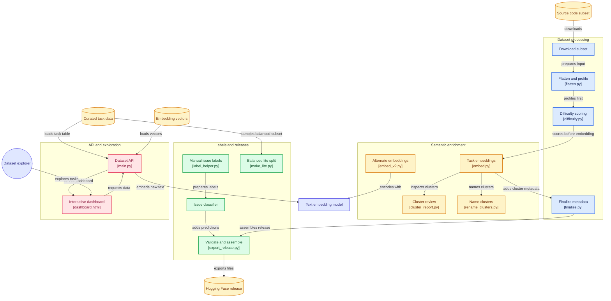

# MiMo-RL Curated
[](https://huggingface.co/datasets/Aswina1636/mimo-rl-curated-code)
[](https://github.com/ASWINa1636/MiMo-RL-Curated)
[](LICENSE)

**A cleaning, enrichment, exploration and search pipeline for the `code` subset of Xiaomi MiMo's reinforcement-learning environments dataset.**

The original tasks are nested records with no filters or summaries. This project flattens them into plain columns, adds profiling and estimated difficulty, groups the tasks into topic clusters, flags near-duplicates, predicts whether each task describes a bug or a feature (with a confidence score), and ships a FastAPI backend and a plain HTML/CSS/JavaScript dashboard to explore the result.

> **Scope:** only the 2,698-task `code` subset is processed. The other subsets of the original dataset (`webdev`, `music`, `cyber`, `general`) are not included.

> This is an independent project. It is **not affiliated with or endorsed by Xiaomi MiMo.**

## Links
- Original dataset: [XiaomiMiMo/MiMo-V2.6-RL-oss](https://huggingface.co/datasets/XiaomiMiMo/MiMo-V2.6-RL-oss)

- Curated dataset (this project): [Aswina1636/mimo-rl-curated-code](https://huggingface.co/datasets/Aswina1636/mimo-rl-curated-code)

- Source code: [ASWINa1636/MiMo-RL-Curated](https://github.com/ASWINa1636/MiMo-RL-Curated)

## Contents
- [At a glance](#at-a-glance)

- [Dashboard](#dashboard)

- [Use the dataset](#use-the-dataset)

- [How the columns were made](#how-the-columns-were-made)

- [Accuracy of the issue-type prediction](#accuracy-of-the-issue-type-prediction)

- [Reproduce the pipeline](#reproduce-the-pipeline)

- [Run the API and dashboard](#run-the-api-and-dashboard)

- [Repository contents](#repository-contents)

- [Limitations](#limitations)

- [Changelog](#changelog)

- [Data and attribution](#data-and-attribution)

## At a glance
| Item | Details |
|---|---|
| Source | `code` subset of XiaomiMiMo/MiMo-V2.6-RL-oss |
| Tasks | 2,698 (full) and 500 (lite) |
| What a task is | A GitHub-issue style description plus the test patch that verifies the fix |
| Public columns | 25 |
| Topic clusters | 20 (KMeans on sentence embeddings, see [How the columns were made](#how-the-columns-were-made)) |
| Issue type | Predicted `bug` or `feature` with a confidence score |
| Embeddings in the release | `all-mpnet-base-v2`, 768 numbers per task |
| Formats | Parquet (tasks and embeddings) |

The lite split takes 25 tasks from each of the 20 clusters. It is balanced on purpose and is **not a random sample**: its class mix and confidence levels differ a little from the full set.

## Processing pipeline
The project is organized as a reproducible sequence of scripts. The exact input and output filenames may depend on which pipeline version you have generated locally.

-  **Download** --- retrieve the source `code` subset.
-  **Flatten and profile** --- extract the issue prompt and nested task metadata, and calculate useful descriptive fields.
-  **Estimate complexity** --- create a relative difficulty score and  split tasks into `easy`, `medium`, and `hard`.
-  **Create embeddings** --- encode task text as numeric vectors for  semantic comparison.
-  **Cluster and inspect similarity** --- group tasks into 20 clusters,and identify nearest-neighbour similarity signals.
-  **Name clusters** --- review cluster samples and assign readable  topic names.
-  **Predict issue type** --- train a bug-versus-feature classifier  from labelled examples and add confidence metadata.
-  **Build the API and dashboard** --- expose statistics, filters, task details, and similar-task search.
-  **Create the release** --- validate the full and lite tables, then

    export the files and dataset card for Hugging Face.

### Main scripts
| Script | Purpose |
|---|---|
| `testing_and_download.py` | Downloads or prepares the original code subset |
| `flatten.py` | Flattens nested records and adds basic profiling fields |
| `difficulty.py` | Calculates the heuristic difficulty score |
| `embed.py` / `embed_v2.py` | Generates text embeddings and similarity features; use the version appropriate to your local pipeline |
| `export_release.py` | Validates and assembles the Hugging Face release folder |
| `main.py` | FastAPI backend for the dataset and similarity features |
| `dashboard.html` | Single-file HTML/CSS/JavaScript dashboard |
| `label_helper.py` | Interactive helper used while preparing issue-type labels |

## Enriched fields
The release contains 25 public columns. The exact schema is defined by the Parquet files and the dataset card on Hugging Face. Important fields

include:

-   `instance_id` --- identifier for a task.
-   `prompt` --- issue/task text.
-   `test_patch` --- test patch supplied with the task.
-   `test_files` and `n_test_files` --- files inferred from the test patch and their count.

-   `prog_language` --- programming language inferred from test-file
    extensions; it may not always equal the main repository language.
-   `prompt_chars` and `prompt_words` --- prompt character and word
    counts.
-   `has_code_block` --- whether the prompt contains a fenced code
    block.
-   `has_chinese` --- whether Chinese characters were detected in the
    prompt.
-   `patch_added`, `patch_removed`, and `patch_lines` --- changed-line
    counts extracted from the test patch where available.
-   `difficulty_score` and `difficulty` --- heuristic complexity score
    and relative bucket.
-   `cluster_id` and `cluster_name` --- semantic cluster identifier and
    human-readable topic name.
-   `nearest_instance_id` and `nearest_sim` --- nearest task identifier
    and similarity score.
-   `near_duplicate` --- flag for tasks whose nearest-neighbour
    similarity exceeds the chosen threshold.
-   `issue_type` --- model-predicted `bug` or `feature`.
-   `issue_type_confidence`, `issue_type_confident`, and
-   `issue_type_tier` --- confidence value and derived confidence
    indicators.

Use the Hugging Face dataset card and the actual Parquet schema as the
source of truth for the complete field list.

## How the derived labels work
### Estimated difficulty
Difficulty is a **relative heuristic**, not a verified measure of how
hard a task is for a person or model. The score combines percentile
ranks for:

-   Test-patch changed-line count: **40%**

-   Number of test files: **30%**

-   Prompt word count: **30%**

Tasks are then divided into approximately equal `easy`, `medium`, and `hard` groups. In the current run, the groups contain 905, 897, and 896 tasks respectively. "Hard" therefore means relatively more complex according to these signals within this dataset; it does not mean that a model has failed the task.

### Semantic clusters and similarity
Task text is converted into embeddings, then KMeans groups the vectors into 20 clusters. Cluster names are human-readable interpretations of samples from each group, not official labels. Similarity scores help surface related tasks, but high similarity does not prove that two tasks are duplicates. Review candidate pairs before removing data.

### Bug-versus-feature prediction
The classifier predicts **bug vs. feature** for tasks that appear to fit those two categories. The model was trained using 350 labelled examples and evaluated with cross-validation on 228 tasks whose original labels were bug or feature.

Reported results from the current experiment:

| Evaluation | Result |
|---|---:|
| Bug-versus-feature accuracy | 87.4% |
| Accuracy when confidence is at least 0.70 | 93.9% |
| Coverage at confidence ≥ 0.70 | 81.1% |
| Accuracy when confidence is at least 0.80 | 97.1% |
| Coverage at confidence ≥ 0.80 | 71.2% |
| Tasks marked confident at confidence ≥ 0.70 | 2,274 / 2,698 |

**Important evaluation caveats:**

-   The evaluation set is small (228 tasks), so the estimates have meaningful uncertainty.
-   The reference labels were largely AI-generated and have **not yet been independently validated by a blind human test**.
-   These metrics measure agreement with the available reference labels, not guaranteed agreement with expert judgement or real-world task outcomes.
-   The binary classifier does not provide a separate `other` class. Tasks that are neither a bug nor a feature may still be forced into one of the two classes.
-   Chinese-language prompts are less reliable with the current English-focused embedding and labelling setup. Their average prediction confidence was lower in the observed run (0.73 versus 0.88 for other prompts).
-   Results may be optimistic because multiple model variants were explored during development.

Treat issue types as predictions, not ground truth. Do not use them as the sole basis for high-impact decisions.

## Architecture


## Dashboard
`dashboard.html` is a single file using plain HTML, CSS and JavaScript. It talks to the FastAPI backend, so there is no React build step and no Node.js requirement.

It has:

- Summary cards: task count, confident issue types, Chinese-language prompts, near-duplicate flags, median prompt length.

- Six charts: difficulty, issue type, programming language, topic clusters, prompt length, classifier confidence. Click a bar to filter the task table.

- A filter bar: text search, difficulty, issue type, language, cluster, Chinese text, "confident type only", sorting.

- A paged task table. Click a row to read the full prompt and see the five most similar tasks.

- A box where you paste a new issue and get the closest tasks in the dataset.

- Light and dark mode, following your system setting.


## Use the dataset
```python

from datasets import load_dataset
lite = load_dataset("Aswina1636/mimo-rl-curated-code", "lite", split="train")
full = load_dataset("Aswina1636/mimo-rl-curated-code", "full", split="train")
easy_english = lite.filter(lambda r: r["difficulty"] == "easy" and not r["has_chinese"])
sure_bugs = full.filter(lambda r: r["issue_type"] == "bug" and r["issue_type_confident"])
print(len(easy_english), len(sure_bugs))

```

`embeddings/mpnet_embeddings.parquet` in the dataset repository holds one vector per task (key: `instance_id`) for similarity search.

### The 25 columns
| Column | Meaning |
|---|---|
| `instance_id`, `orig_index` | Task id and its row index in the original code subset |
| `prompt` | The task text, unchanged from the original |
| `test_patch` | The test patch supplied with the task, unchanged |
| `docker_image`, `verifier_timeout_sec` | Values from the original dataset. The images themselves are not included. |
| `test_files`, `n_test_files`, `patch_lines` | Real test files in the patch, their count, and changed lines. Three helper files added by the original environments are excluded (see [Changelog](#changelog)). |
| `prog_language` | Language of the real test files (rule-based). `Other` means no known extension. It may differ from the project's main language. |
| `prompt_words`, `prompt_chars`, `has_code_block`, `has_traceback`, `has_chinese` | Simple text profile of the prompt |
| `difficulty_score`, `difficulty` | Heuristic complexity score and its easy / medium / hard group |
| `issue_type`, `issue_type_confidence`, `issue_type_confident` | Predicted bug or feature, the model probability, and a flag for probability of at least 0.70 |
| `cluster_id`, `cluster_name` | Topic cluster number (0 to 19) and a short name |
| `near_duplicate`, `nearest_instance_id`, `nearest_similarity` | Closest other task and its similarity. The flag is true above 0.90. |

Removed because they carry no information: `data_source`, `ability`, `agent_name` (the same value in every row), the empty `reward_model.ground_truth`, and `problem_statement` (identical to `prompt`).

## How the columns were made
**Flattening.** The original `prompt`, `reward_model` and `extra_info` columns hold nested lists and a JSON string. They are unpacked into plain columns.

**Estimated difficulty.** This is a relative heuristic, not a measure of how hard a task is for a person or a model. The score is 40% test-patch size, 30% number of real test files and 30% prompt length, each turned into a percentile rank. Tasks are then cut into three equal groups (currently 900 easy, 899 medium, 899 hard). "Hard" means larger than most other tasks in this dataset. A short task can still be hard.

**Programming language.** The first real test file in the patch whose extension matches a known language. This is the language of the tests, so a project in one language can have shell-script tests.

**Topic clusters.** KMeans with 20 clusters on `all-MiniLM-L6-v2` sentence embeddings (random seed 42). The cluster names were written by reading sample tasks from each cluster, so they are approximate. Some clusters group by writing style (many prompts start with "I want...") as well as by topic.

**Near-duplicates.** Cosine similarity of the same MiniLM embeddings, flagged above 0.90. Only one pair is flagged, two related Trino parsing issues, and similar does not mean identical. The published `all-mpnet-base-v2` embeddings are a different model, so neighbours found with them can differ.

**Issue type.** Logistic regression on `all-mpnet-base-v2` embeddings, TF-IDF words and a few text flags. It was trained on about 370 labeled tasks, most of them labeled by an LLM, with a few labeled by hand. Only two classes are predicted. Roughly 9% of tasks in a random sample were judged to be neither a bug nor a feature (refactors, docs, performance, unclear), and the model still calls those bug or feature.

**Chinese text.** `has_chinese` is true when the prompt contains any CJK character, so it also flags some Japanese text.

## Accuracy of the issue-type prediction
| Measure | Result |
|---|---|
| Bug versus feature on tasks that were clearly one of the two (228 tasks, cross-validated) | **87.4%** |
| Only predictions with confidence of at least 0.70 (81.1% of those tasks) | **93.9%** |
| Only predictions with confidence of at least 0.80 (71.2% of those tasks) | **97.1%** |
| Tasks marked confident (at least 0.70) in the released data | 2,274 of 2,698 |

How to read these numbers:

- The truth for the test is the **original** label of each task. Later label corrections were used only as extra training data, so they cannot raise the score.
- The test set is small (228 tasks). Expect about plus or minus 4 to 5 points.
- **No independent human validation has been done yet.** The numbers measure agreement with labels that were mostly produced by an LLM, so they may overstate agreement with human judgment. A blind, human-labeled test set would be the right next step.
- Several model variants were tried while building this, so the numbers may be slightly optimistic.
- Predictions are less reliable for Chinese-language prompts (average confidence about 0.73 versus 0.88 for the rest). The embedding model is English-focused.
- Filter on `issue_type_confident` when you need labels you can trust.

## Reproduce the pipeline
Run everything from the project folder, with the downloaded `code.parquet` in it.

```text

download -> flatten -> difficulty -> keyword labels -> MiniLM embeddings + clusters

         -> name clusters -> finalize -> fix helper files -> MPNet embeddings

         -> classifier -> lite split -> release folder -> API + dashboard

```

| Step | Command | Writes |
|---|---|---|
| 1 | `python testing_and_download.py` | the original code subset |
| 2 | `python flatten.py` | `code_clean.parquet` |
| 3 | `python difficulty.py` | `code_scored.parquet` (first difficulty version, corrected in step 10) |
| 4 | `python issue_type.py` | `code_labeled.parquet` (old keyword labels; `embed.py` reads this file) |
| 5 | `python embed.py` | `embeddings.npy` and `code_embedded.parquet` (MiniLM, clusters, nearest neighbours) |
| 6 | `python cluster_report.py` | `cluster_report.csv` (optional, for reading the clusters) |
| 7 | `python name_clusters.py` | `code_final.parquet` |
| 8 | `python finalize.py` | `code_final_v2.parquet` |
| 9 | `python rename_clusters.py` | renames the clusters in the v2 file |
| 10 | `python fix_harness_columns.py` | recomputes test files, patch lines, language and difficulty without helper files |
| 11 | `python embed_v2.py all-mpnet-base-v2` | `embeddings_all-mpnet-base-v2.npy` |
| 12 | `python train_classifier3.py` | `code_final_v4.parquet` (needs `labels_all.csv` and `labels_all_corrected_plus_candidates.csv`) |
| 13 | `python make_lite.py` | `lite/code_lite_500.parquet` |
| 14 | `python export_release.py` | `hf_release/`, the folder uploaded to Hugging Face |
| 15 | `uvicorn main:app --reload` | the API and dashboard |

Steps 3 and 4 are kept because later steps read their output. The later steps correct their results.

Name steps 7 and 9 depend on the cluster ids from step 5 (KMeans seed 42 on the same embeddings). `name_clusters.py` stops with a message if the ids look different.

Embedding models are downloaded on first use, so you need an internet connection. CPU is enough. A GPU is optional and needs a matching PyTorch install.

## Run the API and dashboard
Python 3.10 or newer is recommended. In PowerShell, from the project folder:

```powershell

python -m venv venv

.\venv\Scripts\Activate.ps1

python -m pip install --upgrade pip

pip install -r requirements.txt

uvicorn main:app --reload

```

If PowerShell blocks activation, use `.\venv\Scripts\activate.bat` from Command Prompt.

`main.py` loads the newest of `code_final_v4.parquet`, `code_final_v3.parquet` or `code_final_v2.parquet`, and `embeddings_all-mpnet-base-v2.npy` (or `embeddings.npy`). Keep them in the project folder or in `data/`. Rows in the task file and the embeddings file must be in the same order.

Open:

- Dashboard: <http://127.0.0.1:8000/>

- API test page: <http://127.0.0.1:8000/docs>

| Endpoint | What it does |
|---|---|
| `GET /health` | Which files are loaded |
| `GET /stats` | Counts by difficulty, issue type, language, cluster, plus histograms |
| `GET /tasks` | Filter and sort: `difficulty`, `issue_type`, `language`, `cluster`, `chinese`, `confident`, `min_confidence`, `min_words`, `max_words`, `q`, `sort_by`, `desc`, `limit`, `offset` |
| `GET /tasks/{instance_id}` | One full task (`include_patch=true` adds the test patch) |
| `GET /similar/{instance_id}` | The most similar tasks |
| `POST /similar-text` | Paste a new issue and get the closest tasks (loads the embedding model on first use, so the first call is slow) |

Example: <http://127.0.0.1:8000/tasks?issue_type=bug&confident=true&difficulty=hard&language=Go&limit=2>

## Repository contents
| Path | Purpose |
|---|---|
| `testing_and_download.py`, `flatten.py`, `difficulty.py`, `issue_type.py` | First pipeline steps |
| `embed.py`, `cluster_report.py`, `name_clusters.py`, `finalize.py`, `rename_clusters.py` | Embeddings, clusters and their names |
| `fix_harness_columns.py` | Removes helper files from the patch-based columns |
| `embed_v2.py` | Embeddings with a stronger model |
| `train_classifier3.py` | Issue-type classifier and the final data file |
| `label_helper.py` | Terminal helper for labeling tasks by hand. Only a few labels were made this way. Most were produced by an LLM. |
| `labels_all.csv`, `labels_all_corrected_plus_candidates.csv` | The training labels, published so the classifier can be audited |
| `make_lite.py`, `export_release.py` | Lite split and Hugging Face release folder |
| `main.py`, `dashboard.html` | API and dashboard |
| `ss/` | Dashboard screenshots |
| `LICENSE`, `requirements.txt`, `.gitignore` | Project files |

Data files (`*.parquet`, `*.npy`) are not stored here. They live on Hugging Face or are generated by the pipeline.

## Limitations
- Only the `code` subset is processed.

- Difficulty, cluster names, duplicate flags and issue-type predictions are derived signals and can be wrong.

- Issue-type accuracy has not been checked against independent human labels. See [Accuracy](#accuracy-of-the-issue-type-prediction).

- Roughly 9% of tasks are neither a bug nor a feature, but the classifier only outputs those two.

- **Do not split this data randomly into train and evaluation sets.** Tasks from the same project can be close neighbours (8 pairs score above 0.80 similarity) and can share context. Repository names are not stored in the dataset, so a split by repository needs them to be recovered from the task text first. The lite split is balanced by cluster and is not meant as a train/eval split.

- Predictions are less reliable for Chinese-language prompts.

- `prog_language` is the language of the tests, not necessarily of the project.

- Languages are unbalanced. Python, Go and JavaScript make up most tasks, and several languages have fewer than 10.

- The lite split is balanced by cluster, so it has more Chinese-language prompts (5.6% versus 3.4%) and a lower share of confident labels than the full set.

- The Docker images and verifiers of the original environments are not included. To run the tasks, use the original dataset.

- Task texts describe third-party open-source projects and come from the original dataset unchanged. They may contain public contact details that appear in the original issue text.

- The API and dashboard need the data and embedding files, which are not in this repository.

This project does not run the software-engineering tasks and does not show how easy a task is for an AI model.

## Changelog
- **v1.1**: `test_files`, `n_test_files`, `patch_lines`, `prog_language` and `difficulty` now ignore three helper files that the original environments add to test patches: `mimo_test_command.sh` (every task), `mimo_build_env.tar.gz.b64` (about 31%) and `test_commands.json` (about 22%). Before, every task counted at least one extra test file, 63 tasks were labeled `Shell` only because of the helper script, and about 21% of tasks sat in a different difficulty group. The lite split was rebuilt.

- **v1.0**: first release.

## Data and attribution
This project is derived from the `code` subset of [XiaomiMiMo/MiMo-V2.6-RL-oss](https://huggingface.co/datasets/XiaomiMiMo/MiMo-V2.6-RL-oss), which is released under Apache-2.0. Task texts and test patches come from that dataset unchanged. Please read the original dataset card for its terms and attribution requirements. The code in this repository is released under the Apache-2.0 license (see [LICENSE](LICENSE)).

## Contributing
Issues and pull requests are welcome. Useful contributions:

- A blind, human-labeled test set for the issue-type classifier.

- Reviewing cluster names and near-duplicate candidates.

- Better handling of Chinese and other non-English prompts.

- More validation and reproducibility checks.

- Extending the pipeline to the other subsets of the original dataset.

## Acknowledgements
Thanks to Xiaomi MiMo for publishing the original MiMo-V2.6-RL-oss dataset and its software-engineering environments.
